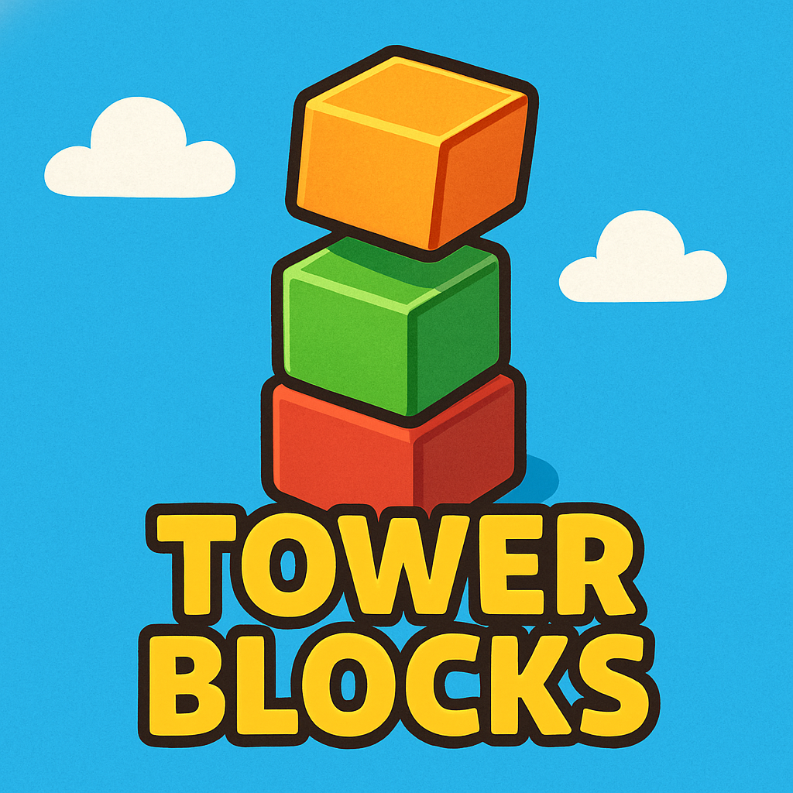

# 🏗️ Tower Blocks

A fast-paced 3D stacking game built with **HTML**, **CSS**, **JavaScript**, **Three.js**, and **GSAP** animations.  
Carefully drop each block to build the tallest tower possible. Experience dynamic lighting, cool sound effects, and a sleek dark mode theme!

---

## 🔗 Live Demo  
➡️ [Play Tower Blocks Live](https://hassanhaseen.github.io/TowerBlocks/)  

---

## 🚀 Features
- 🧱 Add and stack blocks with precise timing
- 🎵 Sound effects on successful placements and game over events
- 🌑 Dark mode design for a modern feel
- 📈 Real-time score tracking
- 📱 Mobile-friendly (Touch and Keyboard Support)
- ⚡ Smooth camera transitions and animations using **GSAP**
- 🖥️ Fully client-side with no server dependencies (aside from third-party libraries)

---

## 🛠️ Tech Stack

- 
- 
- 
- 
- 

---

## 🙌 Credits
- Developed by JC 
- Inspired by classic stacking games and modern WebGL animations

---

feel free to use
